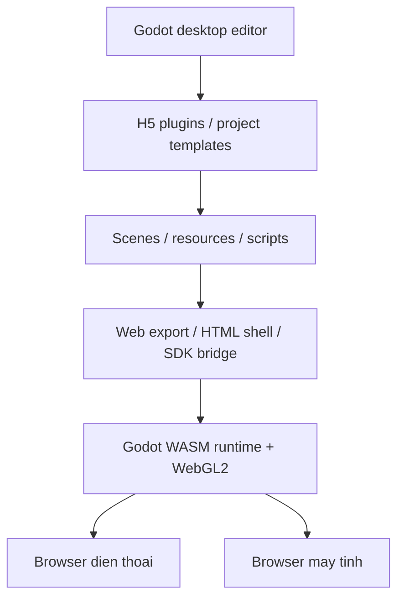
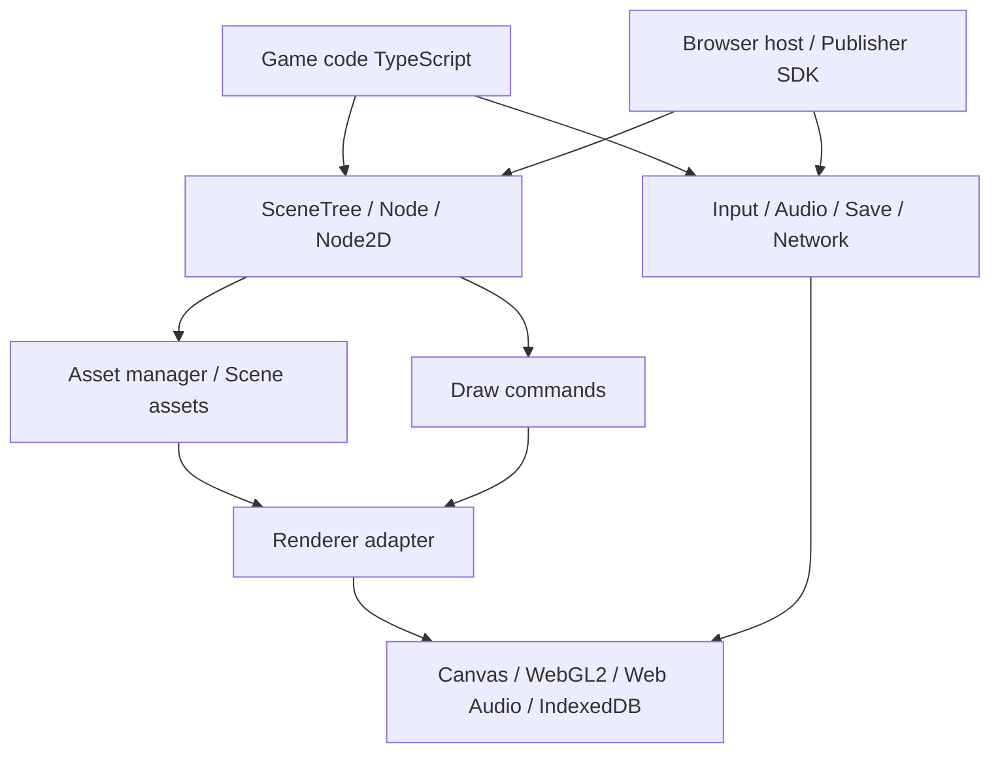

# Đọc Godot để thiết kế engine game web H5

Ngày phân tích và cập nhật: 25/10/2026. Phạm vi người dùng đã xác nhận: một ứng dụng editor desktop giống Godot, dùng để tạo và xuất game H5 chơi trên trình duyệt điện thoại và trình duyệt máy tính. Editor desktop và game chạy trong browser là hai phần của cùng bộ công cụ. 2D là phạm vi prototype đề xuất; nhu cầu 3D, loại game và publisher SDK vẫn cần chốt.

## 1. Kết luận và lựa chọn kiến trúc

**Có thể tiếp tục phát triển trên nền Godot để tạo bộ công cụ H5 có editor desktop. Với phạm vi đã xác nhận, hướng ưu tiên là giữ editor và runtime Godot, bổ sung công cụ H5, pipeline export và tối ưu runtime web.**

| Mục tiêu | Hướng phù hợp | Công việc phải gánh |
| --- | --- | --- |
| Làm game H5 và sớm có editor, scene, animation, UI, physics | Dùng Godot, bổ sung plugin, custom HTML shell, SDK bridge và export template khi cần | Tối ưu game, payload, browser compatibility và tích hợp publisher |
| Xây engine H5 riêng, API TypeScript, kiểm soát từng gói tải và tích hợp web | Viết runtime TypeScript, học các ranh giới kiến trúc của Godot | Tự làm scene lifecycle, assets, render adapter, input, audio, tooling và kiểm thử thiết bị |
| Cần thay đổi sâu engine nhưng muốn giữ hệ sinh thái Godot | Fork Godot C++ và build WASM | Toolchain, merge upstream, phạm vi tính năng và maintenance lâu dài |

Đề xuất hiện tại là **Godot desktop editor + bộ plugin H5 + custom web export + runtime WASM được tối ưu theo nhu cầu**. Có ba mức triển khai tăng dần:

| Mức tùy biến | Việc làm | Khi cần dùng |
| --- | --- | --- |
| Plugin và cấu hình | EditorPlugin, project templates, kiểm tra cấu hình web, EditorExportPlugin, custom HTML shell, JavaScriptBridge | Tạo workflow H5 và tích hợp SDK trên Godot có sẵn |
| Custom build/template | Biên dịch editor desktop hoặc web export template, chọn module/feature, đồng bộ phiên bản | Phân phối bộ công cụ riêng và giảm runtime theo tính năng thực tế |
| Sửa sâu C++ trong fork | Thay đổi editor, web backend, loader hoặc renderer theo nhu cầu đã đo | API plugin và tùy chọn build hiện có chưa đáp ứng |

[EditorPlugin](https://docs.godotengine.org/en/stable/classes/class_editorplugin.html) hỗ trợ mở rộng editor. Hook thêm/bỏ file và tùy biến scene/resource khi export có trong [editor_export_plugin.h:98](<C:/Users/Mark-TA/Desktop/AppGame/reference/godot/editor/export/editor_export_plugin.h#L98>) và [editor_export_plugin.h:120](<C:/Users/Mark-TA/Desktop/AppGame/reference/godot/editor/export/editor_export_plugin.h#L120>). Web preset đã hỗ trợ custom template và HTML shell ở [export_plugin.cpp:370](<C:/Users/Mark-TA/Desktop/AppGame/reference/godot/platform/web/export/export_plugin.cpp#L370>).



Godot đã cung cấp editor desktop, scene, UI, animation, physics, script editor và hệ import. Lõi engine/editor dùng C++; GDScript phù hợp cho game và nhiều plugin; JavaScript kết nối SDK/browser. API TypeScript cho gameplay sẽ là một hạng mục tích hợp scripting riêng nếu cần. Editor và export template tùy chỉnh phải dùng phiên bản tương thích, kiểm thử cùng project mẫu và có kế hoạch cập nhật upstream. Dung lượng, thời gian tải và FPS cần đo trên game/thiết bị thật; bản nghiên cứu hiện tại chưa có benchmark.

## 2. Nguồn tham chiếu và phạm vi đã đọc

Đã tải mã nguồn từ [repository chính thức](https://github.com/godotengine/godot), tag [4.7.2-stable](https://github.com/godotengine/godot/releases/tag/4.7.2-stable), commit **ed1daf0bf001b61586d9930840f2f1394092c079**. Phiên bản cũng được đối chiếu trực tiếp trong [version.py](<C:/Users/Mark-TA/Desktop/AppGame/reference/godot/version.py#L1>).

Bản tham chiếu nằm trong thư mục `reference/godot`, dùng shallow clone và sparse checkout. Các vùng đã lấy gồm main, core, scene, servers, GLES3 driver, web platform, GDScript và một phần editor import/export. Phân tích tập trung vào các đoạn mã bên dưới; chưa phải audit toàn bộ engine. Đây là nghiên cứu mã nguồn tĩnh, chưa có build, game demo hoặc số đo hiệu năng.

| Phần cần học | Điểm bắt đầu trong mã nguồn | Ý nghĩa với H5 |
| --- | --- | --- |
| Vòng lặp chính | [main.cpp:4921](<C:/Users/Mark-TA/Desktop/AppGame/reference/godot/main/main.cpp#L4921>) | Tách fixed tick, cập nhật theo frame và render; giới hạn số physics steps |
| Node và lifecycle | [node.cpp:323](<C:/Users/Mark-TA/Desktop/AppGame/reference/godot/scene/main/node.cpp#L323>) | Quy tắc enter/ready/exit và quan hệ cha con |
| Scene scheduler | [scene_tree.cpp:639](<C:/Users/Mark-TA/Desktop/AppGame/reference/godot/scene/main/scene_tree.cpp#L639>) | Hàng đợi, timer/tween, cập nhật và xóa an toàn |
| Scene serialization | [packed_scene.cpp:155](<C:/Users/Mark-TA/Desktop/AppGame/reference/godot/scene/resources/packed_scene.cpp#L155>) | Dữ liệu scene, instantiate và giải quyết tham chiếu |
| Tài nguyên dùng chung | [resource_loader.cpp:750](<C:/Users/Mark-TA/Desktop/AppGame/reference/godot/core/io/resource_loader.cpp#L750>) | Cache, tái sử dụng yêu cầu và tách tài nguyên khỏi node |
| Signal | [object.cpp:1212](<C:/Users/Mark-TA/Desktop/AppGame/reference/godot/core/object/object.cpp#L1212>) | Snapshot listener, once và deferred callback |
| Transform và sprite | [node_2d.cpp:139](<C:/Users/Mark-TA/Desktop/AppGame/reference/godot/scene/2d/node_2d.cpp#L139>); [sprite_2d.cpp:161](<C:/Users/Mark-TA/Desktop/AppGame/reference/godot/scene/2d/sprite_2d.cpp#L161>) | Scene API gửi transform/lệnh vẽ xuống subsystem |
| Batching renderer 2D | [rasterizer_canvas_gles3.cpp:576](<C:/Users/Mark-TA/Desktop/AppGame/reference/godot/drivers/gles3/rasterizer_canvas_gles3.cpp#L576>) | Gom lệnh vẽ theo trạng thái tương thích |
| Loader trên web | [engine.js:196](<C:/Users/Mark-TA/Desktop/AppGame/reference/godot/platform/web/js/engine/engine.js#L196>) | Boot bất đồng bộ, WASM và game pack |
| Entry C++ trên web | [web_main.cpp:132](<C:/Users/Mark-TA/Desktop/AppGame/reference/godot/platform/web/web_main.cpp#L132>) | Khởi tạo engine và đăng ký vòng lặp trình duyệt |
| Backend WebGL | [display_server_web.cpp:1134](<C:/Users/Mark-TA/Desktop/AppGame/reference/godot/platform/web/display_server_web.cpp#L1134>) | Tạo WebGL2 context, chọn GLES3 backend |
| Export/build | [export_plugin.cpp:370](<C:/Users/Mark-TA/Desktop/AppGame/reference/godot/platform/web/export/export_plugin.cpp#L370>); [SConstruct:264](<C:/Users/Mark-TA/Desktop/AppGame/reference/godot/SConstruct#L264>) | Preset web, custom shell, loại tính năng không dùng |

## 3. Những quy tắc kiến trúc nên học từ Godot

### Scene, node và vòng đời

Godot tổ chức hành vi bằng cây node. `Node2D` thêm transform và đẩy transform sang RenderingServer; sprite mô tả phần texture cần vẽ thay vì trực tiếp điều khiển toàn bộ GPU backend.

Các quy tắc đã đọc trong [node.cpp:323](<C:/Users/Mark-TA/Desktop/AppGame/reference/godot/scene/main/node.cpp#L323>):

- `enter_tree`: cha trước, rồi đến con.
- `ready`: con trước, rồi đến cha; bình thường chỉ gọi lần đầu, có cơ chế yêu cầu ready lại riêng.
- `exit_tree`: các con theo thứ tự đảo, rồi đến cha; rời cây và hủy đối tượng là hai việc khác nhau.

Trong engine riêng, nên công khai chính xác các quy tắc này và giữ `detach/reparent` tách khỏi `dispose`. Node gameplay nên nhỏ; rendering, audio, storage và networking có API riêng.

### Scheduler, thay đổi cây và xóa node

Vòng lặp ngoài ở [main.cpp:4933](<C:/Users/Mark-TA/Desktop/AppGame/reference/godot/main/main.cpp#L4933>) tính số physics steps, giới hạn catch-up ở dòng 4955, rồi chạy cập nhật theo frame và render ở dòng 5061 trở đi. Không nên buộc tốc độ simulation phụ thuộc trực tiếp vào số frame trình duyệt vẽ được.

Trong [scene_tree.cpp:1183](<C:/Users/Mark-TA/Desktop/AppGame/reference/godot/scene/main/scene_tree.cpp#L1183>), scheduler sắp xếp danh sách khi cần, chụp bản sao danh sách trước khi duyệt và bỏ qua node đã bị remove. Một số thao tác thay đổi cây lúc node đang bị khóa sẽ bị từ chối và được khuyên dùng deferred call; Godot không tự chuyển mọi thay đổi cây thành thao tác trì hoãn.

Hàng đợi xóa được xử lý cuối cả physics phase và process phase: [physics phase:655](<C:/Users/Mark-TA/Desktop/AppGame/reference/godot/scene/main/scene_tree.cpp#L655>) và [process phase:719](<C:/Users/Mark-TA/Desktop/AppGame/reference/godot/scene/main/scene_tree.cpp#L719>). `queue_delete` đánh dấu và lưu instance ID ở [scene_tree.cpp:1638](<C:/Users/Mark-TA/Desktop/AppGame/reference/godot/scene/main/scene_tree.cpp#L1638>). Không nên mô tả thành chỉ xóa một lần sau render. Đánh dấu chờ xóa cũng không tự đảm bảo node ngừng mọi callback ngay lập tức.

Đề xuất cho bản TypeScript: mọi add/remove/reparent phát sinh trong lúc duyệt đi qua command queue FIFO; áp dụng ở ranh giới phase rồi xử lý dispose queue. Quy định rõ node chờ dispose có còn được update hay không, và kiểm tra đúng quy định đó.

### Scene asset, tài nguyên và ownership

PackedScene giữ dữ liệu để dựng lại cây; việc lưu scene lọc theo ownership và thuộc tính được đánh dấu lưu, xem [packed_scene.cpp:792](<C:/Users/Mark-TA/Desktop/AppGame/reference/godot/scene/resources/packed_scene.cpp#L792>) và [packed_scene.cpp:866](<C:/Users/Mark-TA/Desktop/AppGame/reference/godot/scene/resources/packed_scene.cpp#L866>). `parent` dùng cho cây runtime và `owner` dùng cho phạm vi lưu scene có vai trò khác nhau.

Quá trình instantiate có lượt giải quyết NodePath thành node sau khi dựng các đối tượng, rồi nối các signal đã lưu: [packed_scene.cpp:597](<C:/Users/Mark-TA/Desktop/AppGame/reference/godot/scene/resources/packed_scene.cpp#L597>). Đây là lý do scene format cần stable ID, schema version và danh sách trường được phép lưu.

ResourceLoader tái sử dụng load token đang chạy và tài nguyên trong cache: [resource_loader.cpp:769](<C:/Users/Mark-TA/Desktop/AppGame/reference/godot/core/io/resource_loader.cpp#L769>) và [resource_loader.cpp:800](<C:/Users/Mark-TA/Desktop/AppGame/reference/godot/core/io/resource_loader.cpp#L800>). Bản H5 nên dùng asset manifest + Promise cache để tránh tải/giải mã cùng asset nhiều lần, hỗ trợ tải theo bundle, hủy tải và báo lỗi.

JavaScript GC không thay thế việc release GPU texture, audio node, listener và timer. Cần tài nguyên có ownership/scope rõ ràng; chỉ giải phóng asset dùng chung khi không còn chủ sở hữu.

### Signal và rendering

Signal ở [object.cpp:1212](<C:/Users/Mark-TA/Desktop/AppGame/reference/godot/core/object/object.cpp#L1212>) chụp snapshot callable/flags, gỡ one-shot trước khi gọi để tránh emit đệ quy, và bỏ qua callable không hợp lệ. Deferred connection được chuyển qua message queue. Bản TypeScript có thể dùng `Signal<T>` với disposer khi đăng ký và quy tắc rõ cho connect/disconnect trong lúc emit.

Batching trong [renderer:602](<C:/Users/Mark-TA/Desktop/AppGame/reference/godot/drivers/gles3/rasterizer_canvas_gles3.cpp#L602>) bị tách khi clip/material thay đổi; texture, blend và trạng thái khác cũng ảnh hưởng batch, xem [renderer:924](<C:/Users/Mark-TA/Desktop/AppGame/reference/godot/drivers/gles3/rasterizer_canvas_gles3.cpp#L924>). Bài học là gom các draw command tương thích để giảm đổi trạng thái và draw call, đồng thời giữ đúng thứ tự hiển thị. Gom theo texture bất chấp z-order/transparency có thể vẽ sai.

Không cần mang sang bản đầu toàn bộ reflection/Variant/ClassDB, GDScript VM, thread group, scene inheritance hay renderer 3D. Một phần mã C++ Godot phụ thuộc nhiều subsystem; tách riêng vài file không tạo thành engine chạy độc lập trong trình duyệt.

## 4. Godot Web hoạt động thế nào và các ràng buộc H5

Đường khởi động thường dùng trong mã nguồn đã đọc:

```text
HTML shell → Engine.startGame()
  ├─ khởi tạo Emscripten/WASM và filesystem
  └─ tải main .pck
       ↓
copy dữ liệu vào filesystem → callMain(args)
       ↓
godot_web_main → OS_Web → Main::setup → Main::start
       ↓
Emscripten main loop → Main::iteration → scene/simulation/render
```

Căn cứ: [khởi tạo WASM/FS](<C:/Users/Mark-TA/Desktop/AppGame/reference/godot/platform/web/js/engine/engine.js#L94>), [copyToFS/callMain](<C:/Users/Mark-TA/Desktop/AppGame/reference/godot/platform/web/js/engine/engine.js#L163>), [startGame](<C:/Users/Mark-TA/Desktop/AppGame/reference/godot/platform/web/js/engine/engine.js#L196>) và [entry C++](<C:/Users/Mark-TA/Desktop/AppGame/reference/godot/platform/web/web_main.cpp#L132>). Godot Web là engine C++ được biên dịch sang WASM với lớp JavaScript kết nối trình duyệt.

| Vấn đề | Điều đã xác minh và ảnh hưởng thiết kế |
| --- | --- |
| Đồ họa | Backend ở [display_server_web.cpp:1134](<C:/Users/Mark-TA/Desktop/AppGame/reference/godot/platform/web/display_server_web.cpp#L1134>) tạo WebGL2, dùng GLES3/Compatibility; đường này không fallback WebGL1. Tài liệu hiện tại cho biết Forward+/Mobile và WebGPU chưa được hỗ trợ trong mô hình export này. |
| Threads | Preset export mặc định tắt threads/extensions ở [export_plugin.cpp:374](<C:/Users/Mark-TA/Desktop/AppGame/reference/godot/platform/web/export/export_plugin.cpp#L374>), nhưng source build mặc định `threads=True` ở [SConstruct:187](<C:/Users/Mark-TA/Desktop/AppGame/reference/godot/SConstruct#L187>). Khi tự build single-thread phải chọn `threads=no` rõ ràng. |
| Hosting/SDK | Pthreads cần SharedArrayBuffer, secure context và cross-origin isolation. Test server Godot dùng COOP `same-origin`, COEP `require-corp` ở [editor_http_server.cpp:108](<C:/Users/Mark-TA/Desktop/AppGame/reference/godot/platform/web/export/editor_http_server.cpp#L108>). Phải kiểm SDK, iframe và tài nguyên cross-origin có đáp ứng policy; không thể kết luận mọi quảng cáo đều bị cấm. Bật extension cũng cần kiểm yêu cầu isolation theo tài liệu. |
| Giao tiếp JavaScript | [javascript_bridge_singleton.cpp:296](<C:/Users/Mark-TA/Desktop/AppGame/reference/godot/platform/web/javascript_bridge_singleton.cpp#L296>) có callback và lấy interface JavaScript. Có thể dùng custom HTML shell và bridge để tích hợp publisher SDK. |
| Audio | Tài liệu mô tả Web Audio Sample giúp giảm latency nhưng hạn chế effects/procedural audio; Stream cung cấp mixer đầy đủ với đánh đổi latency. Cần unlock/resume audio qua tương tác người dùng và kiểm tra iOS Safari thực tế. |
| Lưu dữ liệu | [library_godot_os.js:133](<C:/Users/Mark-TA/Desktop/AppGame/reference/godot/platform/web/js/libs/library_godot_os.js#L133>) mount IDBFS, đọc IndexedDB bất đồng bộ; khi lỗi có thể tiếp tục chạy mà thiếu persistence. Ghi vào filesystem trong RAM và lưu bền vững là hai trạng thái cần phân biệt. |
| Network | Raw socket của web ở [net_socket_web.h:50](<C:/Users/Mark-TA/Desktop/AppGame/reference/godot/platform/web/net_socket_web.h#L50>) trả unavailable. Thiết kế quanh HTTP/fetch, WebSocket hoặc WebRTC phù hợp; chịu CORS và chính sách browser. |
| Tab ẩn/resume | Trình duyệt có thể dừng/throttle callback; phải xử lý visibility, reset/clamp thời gian khi trở lại, và network reconnect. Multiplayer cần đối chiếu thời gian/trạng thái với server. |
| Tải game | Tối ưu cả runtime lẫn asset; đo tải lạnh/tải có cache, WASM init, decode và GPU upload. Tài liệu đề nghị stripped template, gzip/Brotli, MIME WASM phù hợp. |

Nguồn tài liệu cho bảng: [Exporting for the Web](https://docs.godotengine.org/en/stable/tutorials/export/exporting_for_web.html), [bản nguồn văn bản đã đọc](https://docs.godotengine.org/en/stable/_sources/tutorials/export/exporting_for_web.rst.txt), [Compiling for the Web](https://docs.godotengine.org/en/stable/engine_details/development/compiling/compiling_for_web.html). Các trang `stable` có thể được cập nhật; mã nguồn phân tích đã khóa commit.

Để đối chiếu chính xác tác động của isolation tới tài nguyên/iframe/popup: [MDN COEP](https://developer.mozilla.org/en-US/docs/Web/HTTP/Reference/Headers/Cross-Origin-Embedder-Policy) và [MDN COOP](https://developer.mozilla.org/en-US/docs/Web/HTTP/Reference/Headers/Cross-Origin-Opener-Policy).

## 5. Phương án tham khảo: tự viết engine H5 2D

Phần này giữ lại phương án TypeScript để đối chiếu khi cần runtime/API độc lập. Hướng ưu tiên hiện tại là tiếp tục phát triển từ Godot như mục 1; các module và sơ đồ dưới đây là thiết kế thay thế, không phải API hoặc kế hoạch triển khai Godot.



| Module | Phạm vi bản đầu |
| --- | --- |
| core | Clock, scheduler, fixed tick, command/dispose queue, signal, thống kê frame |
| scene | Node, Node2D, SceneTree; local/world transform; load scene JSON có version và registry loại node |
| assets | Manifest theo version/hash, async load/dedup, bundle, atlas, progress/error/cancel, ownership và release |
| renderer | Adapter vẽ sprite/atlas, camera, tint/alpha, z-order, clip và text; đếm draw call/texture |
| input | Pointer/touch/keyboard → action map; quy tắc input edge được tiêu thụ đúng một lần khi có nhiều fixed ticks |
| audio | Web Audio, gesture unlock, nhạc/SFX, pause/resume, mute/volume |
| platform-web | Canvas/CSS/DPR, resize/orientation, visibility/focus, context loss và IndexedDB adapter |
| host-sdk | ready/start/stop, quảng cáo, analytics và save adapter theo publisher; callback lặp vẫn giữ state đúng |
| tools | Desktop editor với scene tree, inspector, asset browser và preview; thiết kế scene schema dùng chung với runtime từ đầu |

Vòng lặp đề xuất dùng requestAnimationFrame và accumulator cho fixed timestep, ví dụ 1/60 giây; giới hạn catch-up để tránh kẹt máy sau khi tab trở lại. Chọn API rõ như `fixedUpdate(dt)`, `update(dt)`, `render(alpha)`, công bố thời điểm flush command/dispose và xử lý input. Chưa có cam kết 60 FPS trước khi đo trên thiết bị mục tiêu.

Loader scene nên dựng off-tree, gán scalar properties và parent links, giải quyết resource/node references, nối signal rồi attach root để chạy lifecycle. Schema chỉ lưu các trường định nghĩa trước; GPU handle, DOM object và function closure thuộc runtime.

Các tình huống phải tính từ đầu: atlas + blending đúng thứ tự, text tiếng Việt/font glyph, pointer cancel, thay đổi kích thước và DPR, WebGL context loss, audio bị suspend, đổi scene khi asset đang tải, quảng cáo kết thúc cùng lúc tab resume, storage quota/private mode, và cache cũ sau deploy.

WASM có thể bổ sung cho phần tính toán cần tái sử dụng C++ hoặc đã đo là nút thắt. Không có yêu cầu kỹ thuật nào buộc runtime H5 mới phải dùng WASM/pthreads ngay từ đầu.

## 6. Lộ trình kiểm chứng trước khi mở rộng

| Mốc | Kết quả cụ thể | Điều kiện để đi tiếp |
| --- | --- | --- |
| 0 — Baseline Godot Web | Dùng editor desktop và một project GDScript nhỏ có sprite, text, mouse/touch, audio, đổi scene và save; xuất Compatibility/WebGL2 | Chơi được cùng project trên browser PC, Android Chrome và iOS Safari mục tiêu; lưu số đo ban đầu |
| 1 — Bộ công cụ H5 trong editor | Plugin tạo project mẫu, cấu hình màn hình/input, kiểm tra lỗi web, preset và lệnh export/preview | Người dùng thao tác trọn luồng từ project trong app desktop tới game được serve trên web |
| 2 — Template và runtime phù hợp | Custom template cùng phiên bản editor; bắt đầu threads=no, extensions tắt nếu chưa cần; giảm 3D/module theo tính năng game | Game mẫu giữ đúng tính năng; so sánh payload, thời gian khởi động, FPS và bộ nhớ trước/sau trên cùng thiết bị |
| 3 — Tích hợp phát hành | Custom HTML shell, JavaScriptBridge/SDK adapter, quảng cáo/pause, save, reconnect, HTTPS/CDN/cache/versioning | Kiểm tra trên domain/iframe/publisher thật, gồm audio và visibility/resume |
| 4 — Bản phân phối và duy trì | Đóng gói editor cùng plugin/template, sửa C++ có phạm vi nếu cần; giữ baseline upstream và kiểm thử cập nhật | Editor và runtime xuất bản tương thích; hai game mẫu khác nhau cùng đi hết pipeline |

Các phép đo cần lưu: dung lượng truyền đã nén cho runtime và phần chơi đầu tiên; thời gian tới tương tác đầu tiên; thời gian load/decode/upload; frame-time p50/p95/p99; draw calls; số texture; và xu hướng bộ nhớ sau nhiều lần đổi scene. Chọn ngưỡng theo thiết bị và gameplay: ví dụ 60 FPS có tổng ngân sách khoảng 16,7 ms/frame, còn đích 30 FPS khoảng 33,3 ms/frame. Các con số này là ngân sách thiết kế, không phải kết quả của nghiên cứu này.

Các ca kiểm thử phù hợp với phần tùy biến Godot: bật/tắt plugin và mở lại project; preset chọn đúng template; scene/resource qua export giữ đúng dữ liệu; touch/mouse và resize; audio/suspend/resume; quảng cáo/pause; lỗi storage/network; và cache phiên bản mới. Prototype đầu tiên cần đi trọn vòng từ editor desktop tới game web có thể chơi, lưu tiến trình, đổi scene và quay lại. Chỉ bổ sung kiểm thử lõi engine cho các thay đổi C++ thực sự thực hiện.

Đối với hướng Godot đã đề xuất, ưu tiên custom HTML shell, plugin và template giảm tính năng theo game. Các tùy chọn giảm 3D/physics/navigation/XR và build profile có trong [SConstruct:264](<C:/Users/Mark-TA/Desktop/AppGame/reference/godot/SConstruct#L264>). Bản sparse hiện tại dùng để đọc; trước khi biên dịch phải lấy lại đầy đủ cây mã nguồn và cài toolchain theo tài liệu. Lệnh sau chỉ mở rộng checkout, chưa được chạy trong nghiên cứu:

```powershell
git -C reference/godot sparse-checkout disable
```

## 7. Giấy phép và quyết định còn cần chốt

Giấy phép MIT trong [LICENSE.txt](<C:/Users/Mark-TA/Desktop/AppGame/reference/godot/LICENSE.txt#L1>) cho phép sử dụng, sửa, phân phối và bán bản phái sinh; cần giữ copyright và permission notice theo điều khoản. Thư viện bên thứ ba có notice riêng cần được giữ khi phân phối phần tương ứng. [Tài liệu license của Godot](https://docs.godotengine.org/en/stable/about/complying_with_licenses.html) giải thích thêm việc đưa notice vào sản phẩm. Giấy phép mã nguồn không đồng nghĩa quyền dùng tùy ý tên/logo/thương hiệu.

Phạm vi đã chốt là editor desktop tạo game H5 cho browser điện thoại và máy tính. Hướng ưu tiên là tiếp tục phát triển từ Godot, dùng lại editor và runtime, bổ sung workflow H5 và tối ưu web export; mức sửa sâu/fork phụ thuộc nhu cầu thực tế. Các lựa chọn còn cần xác định khi triển khai là 2D/3D, thể loại game, browser/thiết bị, SDK và ngân sách tải. Mốc kỹ thuật đầu tiên là **một project demo GDScript được xuất từ Godot desktop, chơi được trên PC và điện thoại**, rồi bổ sung plugin H5 và custom template dựa trên kết quả đo.
